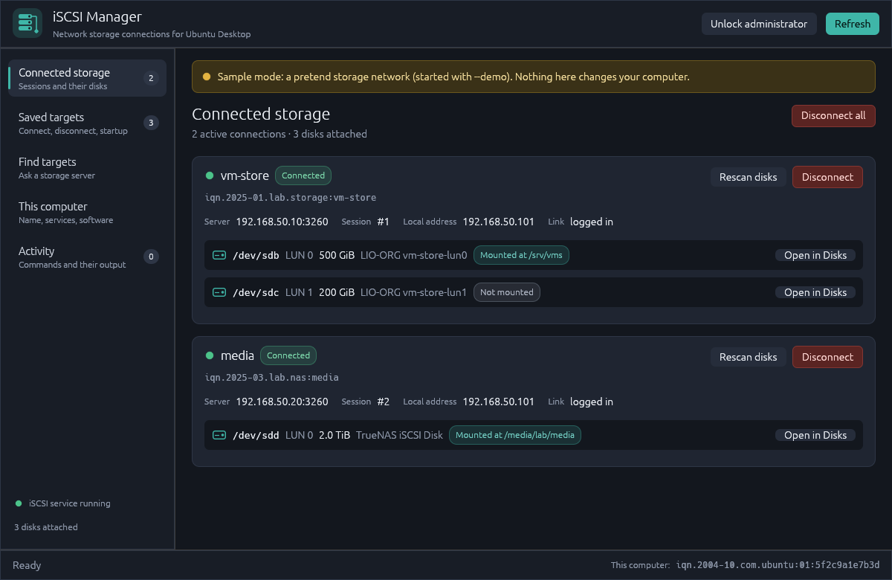

# iSCSI Manager

A desktop app for Ubuntu Desktop 26.04 and newer that finds, connects and manages
**iSCSI network storage** (for example a Synology, TrueNAS or QNAP NAS, or a Linux
storage server) without using the terminal.



## What it does

- **Connected storage**: see every active connection, its server, and the disks it
  added to this computer (size, model, where each disk is mounted). Rescan,
  disconnect, or open a disk in the Disks app to format or mount it.
- **Saved targets**: connect and disconnect, choose which targets reconnect
  automatically at startup, set a username and password (CHAP), or forget a target.
- **Find targets**: type a storage server's address and see the targets it offers.
- **This computer**: show, copy or change this computer's iSCSI name (the initiator
  name), start, stop or enable the iSCSI services, and install open-iscsi.
- **Activity**: every command the app ran, with its output. Passwords are hidden.

The app asks for your password **once per session**, the first time a change needs
administrator rights. Viewing connections needs no password.

If open-iscsi isn't installed yet, the app opens in **sample mode**: it shows a
pretend storage network so you can look around safely, and offers to install
open-iscsi for you.

## Documentation

- [Installation](docs/INSTALL.md): requirements, building, installing and removing.
- [User guide](docs/USER_GUIDE.md): everyday tasks, settings and troubleshooting.

## Quick start

```bash
sudo apt install open-iscsi          # the iSCSI tools this app drives
./install.sh                         # builds and installs for your user
```

Then open **iSCSI Manager** from the app grid.

## Command-line options

| Option | What it does |
|---|---|
| `--demo` | Start in sample mode with a pretend storage network |
| `--page <name>` | Start on `connections`, `targets`, `discover`, `computer` or `activity` |
| `--screenshot <file.png>` | Draw the window, save it as a PNG and exit (used for testing) |
| `--version` | Print the version and exit |
| `--help` | Show the options |
