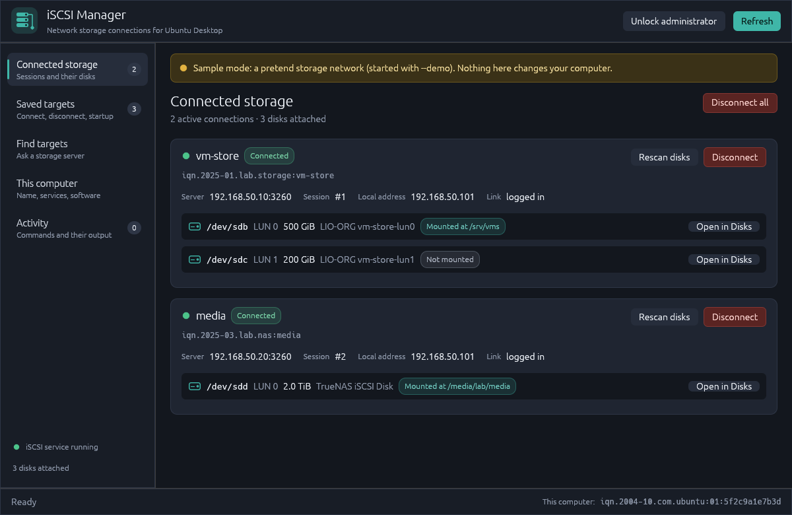
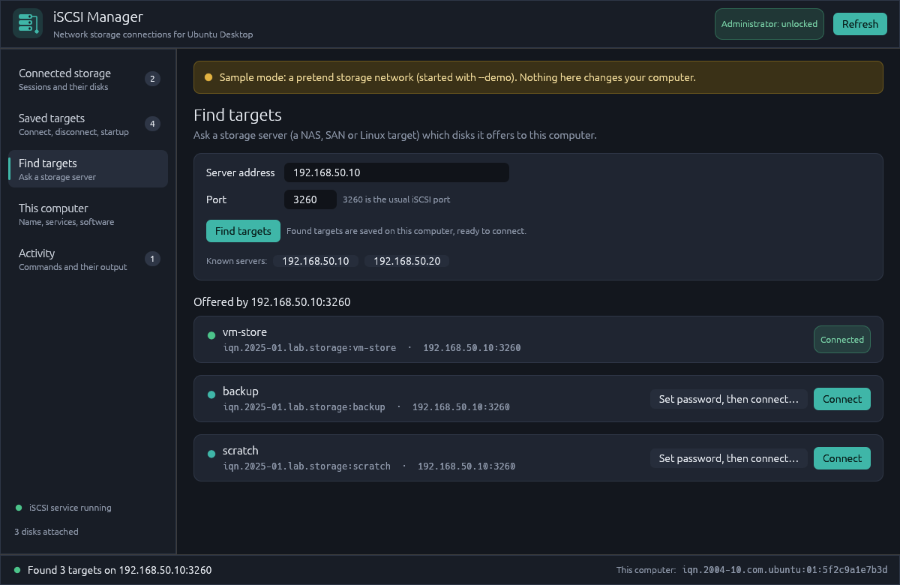

# iSCSI Manager user guide

## What is iSCSI?

iSCSI lets this computer use a disk that lives on another machine (a NAS or storage
server) over the network. Once connected, the disk appears just like a local drive
(for example `/dev/sdb`), and you can format it, mount it and store files on it.

A few words you'll see in the app:

| Word | Meaning |
|---|---|
| **Storage server** (portal) | The NAS or server that shares the disks, with its address and port, e.g. `192.168.1.50:3260` |
| **Target** | One shared item on the server, with a long name such as `iqn.2000-01.com.synology:MyNAS.Target-1`. A target can hold one or more disks |
| **LUN** | One disk inside a target (LUN 0, LUN 1, …) |
| **iSCSI name** (initiator name) | This computer's name in iSCSI. Servers use it to decide who may connect |
| **CHAP** | An optional username and password the server asks for when you connect |
| **Session** | An active connection to a target |

## The window

- **Top bar**: **Unlock administrator** asks for your password once, so later changes
  don't ask again until you close the app. **Refresh** reads the current state
  again. The app also refreshes by itself every 15 seconds. A spinner and *Working…*
  show while a command runs.
- **Left side**: the five pages, with counts. At the bottom you can see whether the
  iSCSI service is running and how many disks are attached.
- **Bottom bar**: the result of the last action (green dot = done, red = failed) and
  this computer's iSCSI name.

## Before your first connection

1. Open **This computer** and copy the **iSCSI name**.
2. On the storage server, allow that name to use the target:
   - Synology: *SAN Manager → iSCSI → (target) → Edit → Masking*, or *Hosts*. Add a
     host with this iSCSI name and give it access.
   - TrueNAS: *Shares → Block (iSCSI) → Initiators*.
   - Other servers have a similar "initiators", "hosts" or "access list" setting.
3. If the server uses CHAP, write down its username and password.

## Common tasks

### Find and connect a new target

1. Open **Find targets**.
2. Type the server's address (an IP address or a name like `nas.local`). Keep port
   **3260** unless the server uses another one.
3. Press **Find targets** (or Enter). The first time, Ubuntu asks for your password.
4. The targets the server offers are listed. Already connected ones show
   **Connected**.
5. Press **Connect**. If the server needs a password, use **Set password, then
   connect…** instead.

Found targets are also saved, so next time they're already in **Saved targets**.
The **Known servers** buttons fill in addresses you've used before.

### See what's connected

Open **Connected storage**. Each connection shows:

- the target's short name and full name, the server, the session number, this
  computer's network address and the link state;
- each disk: device name (`/dev/sdb`), LUN, size, model, and where it's mounted, or
  *Not mounted*.

**Rescan disks** looks for disks that were added or resized on the server since
you connected.

### Use a new disk (format and mount)

A newly connected disk is empty or has its own file system. Use the **Disks** app:

1. On **Connected storage**, press **Open in Disks** next to the disk.
2. In Disks, check that the selected disk matches the size and model shown in iSCSI
   Manager. Formatting erases everything on the disk.
3. Create a partition (for example *Ext4*), then press the ▶ button to mount it.
4. To mount it automatically after a restart, open *Additional partition options →
   Edit Mount Options* and add **`_netdev`** to the options. This tells Ubuntu to
   wait for the network before mounting. Without it, startup can hang while it
   waits for a disk that isn't connected yet.

Also tick **Connect at startup** for the target (see below). Otherwise the disk
won't be there to mount.

### Disconnect

- One target: **Disconnect** on *Connected storage* (asks for confirmation) or on
  *Saved targets*.
- Everything: **Disconnect all** on *Connected storage*.

**Unmount the disks first** (in Files or Disks) and close any open files on them.
Disconnecting a disk that is still in use can lose data.

### Connect automatically at startup

On **Saved targets**, tick **Connect at startup** for the target. Untick it to
connect only by hand. **Connect all startup targets** connects all ticked targets
now.

For this to work after a restart, the services on **This computer** must have
**Start at boot** ticked: *iscsid*, and *open-iscsi*, which does the reconnecting.

### Username and password (CHAP)

On **Saved targets**, press **Login settings…**:

- **No password**: the server allows this computer by its iSCSI name.
- **User name and password (CHAP)**: enter what the server expects. Many servers
  need a password of 12 to 16 characters. Leave the password empty to keep the one
  already saved.
- **The server proves itself too (mutual CHAP)**: the server also has to give a
  username and password. Only use this if the server is set up for it.

Press **Save**. The new settings apply the next time you connect: disconnect and
connect again if the target is already connected. Passwords are saved by open-iscsi
in a folder only administrators can read. The app never shows them, and the
Activity page hides them.

### Forget a target

On **Saved targets**, press **Remove**. If the target is connected, it is
disconnected first. Only this computer's saved settings are removed. The data on
the server is not touched, and you can find the target again later.

### Change this computer's iSCSI name

On **This computer**, press **Change…**. Type a new name or press **Make a new
one**, then **Save**. Disconnect all storage first; the app won't save while
anything is connected. Afterwards, update the allowed initiators on your storage
servers with the new name.

### Services and software

**This computer** shows:

- **iscsid**: talks to storage servers. It must be **Running** for anything to work.
- **open-iscsi**: reconnects *Connect at startup* targets when the computer
  starts. It may show as stopped when nothing needs reconnecting. It only needs
  **Start at boot**.
- **Start**, **Stop**, **Restart** and **Start at boot** for each service.
- Whether open-iscsi is installed, with an **Install open-iscsi** button if it isn't.

## The Activity page

Every action is listed with a green (worked) or red (failed) dot. Open an entry to
see the exact commands, their exit codes and what they printed. Lines starting with
`#` ran with administrator rights. This is the first place to look when something
fails. Use **Clear** to empty the list.

## Administrator password

- Viewing connections and service status works without a password.
- The first time you connect, disconnect, find targets or change a setting, Ubuntu
  shows its password prompt. After that, the app stays unlocked until you close it.
- The **Saved targets** list needs administrator rights to read. Until you unlock,
  it may show no targets and a yellow note with an **Unlock** button.
- If you cancel the prompt, the action fails with *Administrator permission was not
  given*. Just try again.

## Sample mode

If open-iscsi isn't installed, or you start the app with `--demo`, a yellow banner
says **Sample mode**. The app then shows a pretend network with two servers
(`192.168.50.10` and `192.168.50.20`) and a few targets. Everything works the same,
but nothing changes on your computer. The *scratch* target always refuses to
connect, so you can see what a login error looks like.

## Troubleshooting

| Message or symptom | What it means and what to do |
|---|---|
| *It was already connected* | The target already had a session, so nothing needed doing |
| *Couldn't reach the server* | Check the address and port, that the server is on, and that a firewall isn't blocking port 3260 |
| *Login was refused* | Wrong CHAP username or password, or the server doesn't allow this computer's iSCSI name. Check both on the server |
| *The server didn't answer in time* | Network problem or a busy server. Try again |
| *The iSCSI service (iscsid) isn't running* | Go to **This computer** and press **Start** next to iscsid |
| *The saved settings couldn't be changed* | The target is probably still connected. Disconnect it first (for Remove) |
| *Administrator permission was not given* | The password prompt was cancelled. Try again |
| Saved targets list is empty | Press **Unlock administrator**. The list needs administrator rights to read |
| Connected, but no disk appears | Press **Rescan disks**. If still nothing, check on the server that the target has a LUN and that this computer is allowed to see it |
| The disk is there but not in Files | It isn't formatted or mounted yet. See *Use a new disk* |
| Startup hangs after adding a mount | Add `_netdev` to the mount options (see *Use a new disk*) |

For anything else, open the **Activity** page and read the last lines of the failed
command's output.

## Keyboard and mouse

- **Enter** in the server address field starts *Find targets*.
- **Escape** or clicking outside closes a dialog without saving.
- Hover over a button to see a short explanation.
